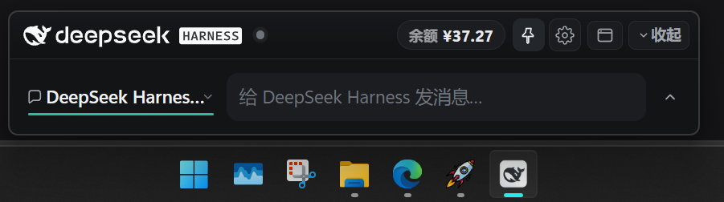
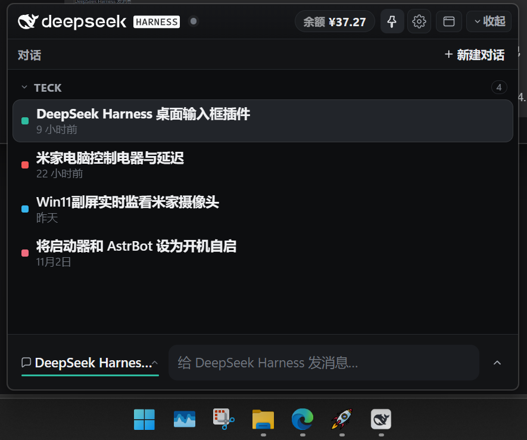
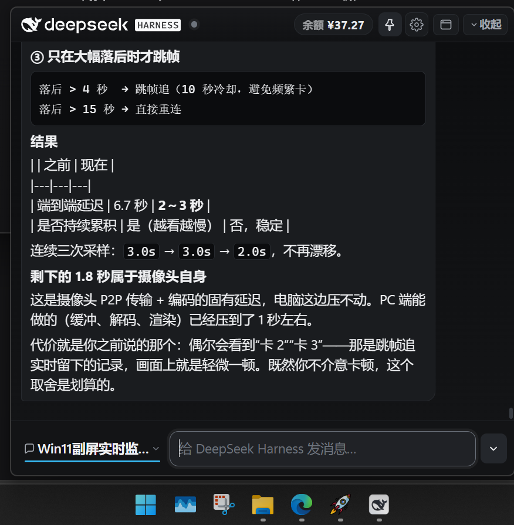

# DSH 快捷栏（dsh-floating-input）

给 **DeepSeek Harness 桌面版** 用的常驻悬浮快捷输入栏。它是一个独立的原生置顶窗口，可以浮在浏览器、编辑器、游戏等任何窗口前面；桌面版和快捷栏可以同时使用，互不影响。



## 基本功能

- **随时输入**：`Enter` 发送，`Shift+Enter` 换行；输入框实时显示思考、工具调用和生成状态。
- **实时流式回复**：展开回复面板后，可以边生成边看内容，不需要等整轮结束。
- **对话切换**：左侧按钮打开对话列表，按工作区分组；支持置顶、归档、新建和切换对话。
- **对话颜色**：同一工作区内随机分配不重复颜色；快捷栏顶部显示当前对话色条，对话列表和桌面版侧栏显示颜色方块；已归档对话统一灰色。
- **状态灯**：灰色空闲、蓝色呼吸运行中、红色呼吸等待确认、绿色完成。
- **余额与用量**：顶部显示 DeepSeek API 余额，点击直接打开开放平台用量页面。
- **快捷收起**：右上角收起为一条顶部栏；再次展开恢复输入框和面板。
- **全局快捷键**：可分别绑定“唤起”和“收起”快捷键；唤起后自动聚焦输入框。
- **位置与设置记忆**：窗口位置、展开方向、字号、停靠位置、快捷键和附加提示词都会持久化。
- **任务栏停靠**：支持自由、任务栏正上方居中、最左三个位置。
- **原生置顶**：图钉按钮控制是否始终位于所有窗口最前；不额外创建托盘图标。

## 截图

### 对话列表

按工作区分组，标题左侧显示颜色方块。



### 展开回复

实时显示思考/工具状态和流式文本，支持 Markdown 和代码块。



## 安装

要求：Windows 10/11、DeepSeek Harness 桌面版、Microsoft Edge WebView2 Runtime。

1. 把本目录放到 DSH profile 的插件目录，或使用链接依赖：

```json
{
  "dependencies": {
    "dsh-floating-input": "link:D:\\path\\to\\dsh-floating-input"
  },
  "dsh": {
    "profile": {
      "bundles": [
        "@deepseek-ai/dsh-base",
        "@deepseek-ai/dsh-web-app",
        "dsh-floating-input"
      ]
    }
  }
}
```

2. 在 profile 的 `cordis.patch.yml` 中按需开启启动时自动打开：

```yaml
- id: dsh-floating-input
  name: dsh-floating-input
  config:
    autoStart: true
```

3. 安装或修改 Host 代码后，从系统托盘**完全退出 DSH 再重新打开**。
4. 桌面版标题栏会出现 `快捷栏` 菜单入口；也可以使用绑定好的全局快捷键打开。

## 使用

- 拖窗口左右边缘调宽度；展开面板后拖底边调面板长度。
- 设置里可以修改唤起/收起快捷键、展开方向、停靠位置、字号和附加提示词。
- 桌面版标题栏的 `快捷栏` 只控制快捷栏显示/隐藏，不会退出桌面版。
- 快捷栏内的窗口图标可以呼出/最小化桌面版。

## 目录

```text
lib/                  DSH Host 插件与 HTTP API
overlay/              WebView2 页面
helper/               原生窗口可执行文件
helper-src/           原生窗口源码（WPF + WebView2）
docs/                 截图
```

## License

MIT
